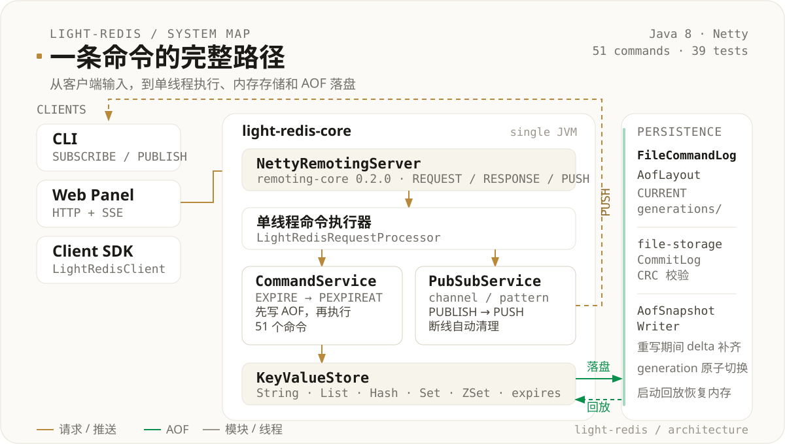

<h1 align="center">light-redis</h1>

<p align="center">
  <strong>用 Java 从零实现的轻量级 Redis 学习项目</strong><br>
  数据结构 · TTL · AOF 重写 · 发布订阅 · CLI + Web 控制台
</p>

<p align="center">
  
  
  
  
  
</p>

light-redis 不是 Redis 的完整替代品，而是一个把 Redis 核心机制拆开、跑通并可视化的单机学习项目。

它包含一个 Netty 服务端、一个客户端核心、一个交互式 CLI，以及一个本地 Web 控制台。你可以用它练习五种数据结构、key 过期、AOF 持久化与后台重写、发布订阅，也可以直接在面板里浏览 key、执行命令、查看 TTL 和接收订阅消息。

> 当前边界：自定义文本协议（非 RESP）、单机、无事务 / RDB / 主从复制 / 集群 / 内存淘汰。适合学习和二次开发，不建议直接用于生产。

## 快速开始

环境要求：**JDK 8+**、**Maven 3+**。Windows 推荐使用 Git Bash 或 WSL，也可以在 IDE 中直接运行 main 方法。

```bash
# 1. 构建
mvn clean install -DskipTests

# 2. 启动服务端，默认 127.0.0.1:6379，开启 AOF
./server.sh

# 3. 另开一个终端，启动 CLI
./cli.sh

# 4. 或启动 Web 控制台
./panel.sh
# 浏览器打开 http://127.0.0.1:8080
```

启动成功后，CLI 会进入交互模式：

```text
Connected to 127.0.0.1:6379, type "quit" or "exit" to close.
Use SUBSCRIBE <channel> or PSUBSCRIBE <pattern> to receive messages.
127.0.0.1:6379> SET demo:string "hello world"
OK
127.0.0.1:6379> GET demo:string
hello world
```

服务端参数：

```text
--data-dir <path>       AOF 数据目录，默认 ./data/light-redis
--appendonly <yes|no>   是否开启 AOF，默认 yes
-h, --help              查看帮助
```

也可以用环境变量覆盖：

```bash
DATA_DIR=./data/demo APPENDONLY=no ./server.sh
REDIS_HOST=127.0.0.1 REDIS_PORT=6379 ./panel.sh
```

## 核心能力

| 方面 | 当前实现 |
|---|---|
| 数据结构 | String / List / Hash / Set / Sorted Set；错误类型返回 `WRONGTYPE` |
| 命令 | 51 个：读写、key 管理、TTL、持久化、发布订阅 |
| 过期 | 惰性删除 + 每 100ms 抽样删除；`TTL` / `PTTL` / `PERSIST`；TTL 随 AOF 持久化 |
| 持久化 | 写命令先落 AOF 再执行；启动回放；后台重写；`CURRENT` + generation 原子切换 |
| 发布订阅 | 频道 / glob 模式订阅；`PUBLISH`；`PUBSUB` 查询；服务端 `PUSH` 推送 |
| Web 控制台 | 命令控制台、按 `:` 分层的 key 树、键详情、TTL 展示、订阅消息、服务状态 |
| 通信 / 线程 | Netty IO 多线程 + 单线程命令执行；自定义文本协议，支持引号与转义 |

## 架构

<p align="center">
  
</p>

一次写命令的完整路径：

1. 客户端通过 `remoting-core` 发送一条 `REQUEST`。
2. Netty 把请求交给单线程命令执行器 `light-redis-command-executor`。
3. `LightRedisRequestProcessor` 把发布订阅命令交给 `PubSubService`，其余命令交给 `CommandService`。
4. `CommandService` 先把写命令追加到 AOF，写成功后交给 `CommandDispatcher` 修改内存。
5. `KeyValueStore` 更新五种数据类型和 `expires`；读命令按需触发惰性过期。
6. 发布订阅通过 `RemotingServer.push` 把 `PUSH` 帧写回订阅连接。

模块依赖：

```text
light-redis-core     -> remoting-core 0.2.0 + file-storage 0.1.0
light-redis-client   -> remoting-core 0.2.0
light-redis-cli      -> light-redis-client + picocli
light-redis-panel    -> light-redis-client + picocli + JDK HttpServer
```

`light-redis-core` 不依赖客户端或展示模块。CLI、面板和后续 SDK 都复用 `light-redis-client`。

```text
light-redis/
├── light-redis-core/       # 协议、命令、存储、TTL、AOF、发布订阅、启动入口
├── light-redis-client/     # 同步/异步命令调用、连接管理、订阅消息监听
├── light-redis-cli/        # picocli 交互式客户端
├── light-redis-panel/      # HTTP API、SSE 订阅、静态页面
├── assets/readme/          # README 架构图
├── server.sh
├── cli.sh
└── panel.sh
```

线程模型：

- Netty 层：1 个 boss 线程接受连接，N 个 worker 线程负责网络读写。
- 命令层：所有数据命令、TTL 命令、发布订阅命令在同一个命令线程串行执行。
- 过期任务：定期删除提交到命令线程，避免和读写命令交错。
- 推送：`PUBLISH` 在命令线程执行，写回客户端由 Netty 异步完成。
- 重写：`BGREWRITEAOF` 和自动重写在后台线程生成新 generation。

## 使用方式

### 五种数据结构

```text
❯ SET demo:string "hello world"
OK
❯ GET demo:string
hello world

❯ RPUSH demo:list a b c
3
❯ LRANGE demo:list 0 -1
a
b
c

❯ HSET demo:hash name tom age 20
2
❯ HGETALL demo:hash
name
tom
age
20

❯ SADD demo:set a b c
3
❯ SMEMBERS demo:set
a
b
c

❯ ZADD demo:zset 1 one 2 two
2
❯ ZRANGE demo:zset 0 -1 WITHSCORES
one 1
two 2
```

集合类 key 在删除最后一个元素后会自动删除。列表、集合、哈希和有序集合的多个结果使用换行分隔。

### 过期时间

```text
❯ SET demo:ttl hello
OK
❯ EXPIRE demo:ttl 60
1
❯ TTL demo:ttl
60
❯ PERSIST demo:ttl
1
❯ TTL demo:ttl
-1
```

语义：

- `TTL` 返回 `-2` 表示 key 不存在，`-1` 表示没有过期时间。
- `EXPIRE` / `PEXPIRE` 的非正数会立即删除 key。
- `SET` 会清除 TTL；`LPUSH` / `HSET` / `SADD` 等修改已有 key 的操作保留 TTL。
- `EXPIRE` / `PEXPIRE` / `EXPIREAT` 写入 AOF 前会归一化为绝对时间 `PEXPIREAT`。

### 发布订阅

两个客户端：

```text
# 客户端 A
❯ SUBSCRIBE demo:channel
subscribed demo:channel
[demo:channel] hello

# 客户端 B
❯ PUBLISH demo:channel hello
1
```

模式订阅：

```text
❯ PSUBSCRIBE demo:*
psubscribed demo:*
[pattern:demo:*] demo:tech hello
```

管理命令：

```text
❯ PUBSUB CHANNELS
demo:channel
❯ PUBSUB NUMSUB demo:channel
demo:channel 1
❯ PUBSUB NUMPAT
1
```

说明：

- 订阅关系属于连接级别，不写入 AOF，连接断开后自动清理。
- `PUBLISH` 不修改 key，也不写入 AOF；返回收到消息的订阅数量。
- 同一连接同时命中频道订阅和模式订阅时，会分别收到 `message` 和 `pmessage`。
- 重复订阅同一频道只保留一份关系。
- CLI 不进入严格订阅模式，订阅后仍然可以继续发送普通命令。
- 面板控制台不允许直接 `SUBSCRIBE` / `PSUBSCRIBE`，请使用「订阅」标签页；`PUBLISH` 和 `PUBSUB` 可以在控制台执行。

### Web 控制台

面板是独立进程，通过 `light-redis-client` 连接服务端：

```bash
./panel.sh
# http://127.0.0.1:8080
```

三个区域：

- 左侧：按 key 中的 `:` 分层折叠的 key 树，目录节点显示后代数量。
- 中间：命令控制台、键详情、订阅三个标签页；键详情展示类型、TTL 和值。
- 右侧：运行时长、命令数、连接数、key 数量、过期删除数、JVM 内存和线程数。

控制台顶部提供通用、Pub/Sub、String、List、Hash、Set、ZSet 快捷命令。订阅标签页通过 SSE 建立独立连接，输入频道即可实时接收消息；控制台里的 `PUBLISH` 可以直接向该频道发消息。

### 面板 API

面板只监听 `127.0.0.1`：

| 方法 | 路径 | 说明 |
|---|---|---|
| GET | `/api/ping` | 检查服务端连接 |
| GET | `/api/status` | 执行 `INFO` 并返回结构化状态 |
| POST | `/api/command` | body 为原始命令文本 |
| GET | `/api/keys?pattern=*` | 执行 `KEYS` |
| GET | `/api/key?name=...` | 类型、TTL 和值 |
| DELETE | `/api/key?name=...` | 删除单个 key |
| GET | `/api/subscribe?channel=...` | SSE 订阅频道，也支持 `?pattern=...` |

`POST` / `DELETE` 需要请求头 `X-Light-Redis-Panel: 1`。`/api/subscribe` 是长连接 SSE 流，校验 `Host` 和可选的 `Origin`。

```bash
curl -s -X POST \
  -H 'Content-Type: text/plain' \
  -H 'X-Light-Redis-Panel: 1' \
  --data 'SET panel:key hello' \
  http://127.0.0.1:8080/api/command

curl -N 'http://127.0.0.1:8080/api/subscribe?channel=demo:channel'
```

安全说明：

- 面板只绑定回环地址，没有认证；任何本机进程都可以调用 API，不要暴露到公网。
- 前端动态内容使用 `textContent` 渲染，避免 key / value 注入 HTML。
- `POST` / `DELETE` 校验自定义请求头，降低浏览器跨站调用风险。

## 持久化

默认启用 AOF：

- 写命令先追加到 `mini-file-storage` 的 CommitLog，追加成功后才修改内存。
- 启动时通过自定义 `RedisRecoveryIndex` 回放历史命令，不依赖手动 `scan`。
- 每条命令默认 `syncFlush=true`，返回客户端前强制刷盘。
- 语法或类型错误的写命令也会进入 AOF，回放时记录警告并跳过。
- `PUBLISH`、`SUBSCRIBE` 等发布订阅命令不进入 AOF。
- 直接执行 `./server.sh` 就会从默认的 `./data/light-redis/CURRENT` 指向的 generation 自动回放，不需要额外指定参数。

重写：

```text
BGREWRITEAOF
```

1. 在命令线程边界记录旧 AOF 逻辑末尾位点。
2. 后台从旧 AOF 前缀回放到临时内存 store。
3. 生成紧凑命令：`SET`、`RPUSH`、`HSET`、`SADD`、`ZADD`，有 TTL 的 key 补写 `PEXPIREAT`。
4. 重写期间的写命令继续写旧 AOF，同时进入 delta 队列。
5. 快照完成后追加 delta，短暂停止写入，原子切换 `CURRENT`。

自动触发默认条件：

```text
逻辑日志 >= 16MB
且达到上次重写后大小的 2 倍
每 1 秒检查一次
```

目录结构：

```text
data/light-redis/
├── CURRENT                       # 当前 generation 指针
├── data/                         # 初始 generation
├── store.properties
├── checkpoint.properties
└── generations/
    └── gen-<timestamp>-<seq>/    # 重写后的 generation
```

旧 generation 当前不会自动清理。

## 命令参考

| 分类 | 命令 |
|---|---|
| 通用 | `PING` `DEL` `EXISTS` `TYPE` `KEYS` `DBSIZE` `INFO` |
| TTL | `EXPIRE` `PEXPIRE` `EXPIREAT` `PEXPIREAT` `TTL` `PTTL` `PERSIST` |
| String | `SET` `GET` |
| List | `LPUSH` `RPUSH` `LPOP` `RPOP` `LLEN` `LRANGE` `LINDEX` `LSET` `LREM` |
| Hash | `HSET` `HGET` `HDEL` `HEXISTS` `HLEN` `HGETALL` `HKEYS` `HVALS` |
| Set | `SADD` `SREM` `SMEMBERS` `SISMEMBER` `SCARD` |
| Sorted Set | `ZADD` `ZREM` `ZSCORE` `ZCARD` `ZRANGE` `ZRANK` |
| 发布订阅 | `SUBSCRIBE` `UNSUBSCRIBE` `PSUBSCRIBE` `PUNSUBSCRIBE` `PUBLISH` `PUBSUB` |
| 持久化 | `BGREWRITEAOF` |

关键语义：

- `KEYS` 支持 `*` 和 `?` glob，没有 `SCAN`，大 key 空间下会阻塞。
- `SET` 会覆盖任意类型的 key，并清除原有 TTL。
- 集合类 key 删除最后一个元素后自动删除。
- 命令参数支持单/双引号和反斜杠转义；字符串内容本身不建议包含换行。
- 当前协议是自定义文本协议，不是 RESP；现有 Redis 客户端不能直接连接。

## 测试

```bash
mvn clean test
```

当前 **39 个测试**，覆盖：

- AOF 编解码、启动恢复、失败命令跳过
- AOF 后台重写、连续重写、重写期间写入
- TTL 惰性删除、定期删除、重启恢复、重写保留
- 发布订阅频道、模式、去重、取消订阅、连接清理
- 服务端参数解析

## 后续可扩展

- 协议：RESP2 / RESP3、二进制安全、pipeline
- 命令：`SCAN`、`MGET` / `MSET`、集合运算、更多 ZSet 范围查询
- 语义：`MULTI` / `EXEC` / `WATCH`、`BLPOP` 等阻塞命令
- 持久化：RDB 快照、AOF fsync 策略、旧 generation 自动清理
- 高可用：主从复制、Sentinel、Cluster
- 运维：`CONFIG`、`CLIENT`、`SLOWLOG`、`MEMORY`、内存淘汰
- 发布订阅：键空间通知、慢消费者限制

## 说明

这是一个学习项目，优先保证机制清晰、代码可读和可验证，而不是生产级的性能与兼容性。如果你在阅读源码，建议从 `light-redis-core` 的 `LightRedisApplication`、`CommandService`、`InMemoryKeyValueStore`、`FileCommandLog` 和 `PubSubService` 入手。
